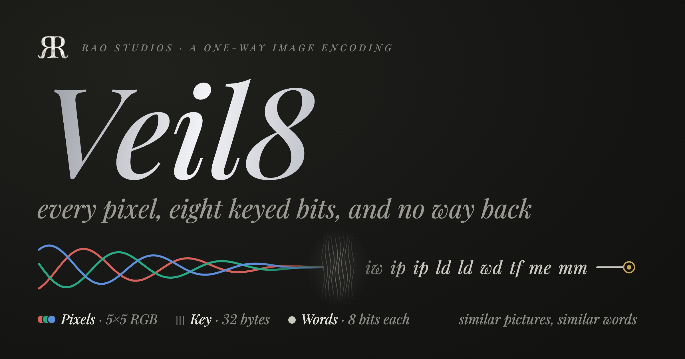

[](README_Assets/hero.png)

# Veil8

A picture, as text a machine can compare but no one can read back.

Veil as a project started from CLR ([Blog Post 1](https://rao.nyc/thoughts/2026-04-25), [Blog Post 2](https://paka.la/blog/clr-journey)). A journey that actually had an earlier origin "Garde" hence the name in [VeilGarde](https://github.com/riteshpakala/VeilGarde).

There are 3 key processes in protecting generated visuals. The generation layer, watermarking, and detection. Each 3 are accounted for today and are being actively researched with a focus on model-agnosticism. Veil8 is a necessary step in both generation and detection as it helps storing visual data while preserving the privacy of the source. Encoding data 1-way allows for data collection to not reveal its visual truth while providing the features that are required to make these systems functional.

Veil8 turns an image into 32×32-pixel tiles and writes each tile as a string of 1024 two-letter
words — one word per pixel, eight one-bit measurements of the pixel's neighbourhood under a key
that never leaves the machine. The string cannot be turned back into the pixels. That is what [Veil](https://veil.rao.nyc) builds on to attribute what a diffusion model draws to the protected images it drew from, without the protected images ever leaving the machine that holds them.

This package is the encoding, the process that gets a picture to it, and the key. The goal is to standardize this procedure for other engineers or firms building risk management solutions in the generative space and want to be more careful with what data enters their system while building the very solutions that defend, protect, and secure generative systems.

```swift
import Veil8

let key = try Veil8Key.loadOrCreate(at: keyFile).key          // 32 bytes, 0600, made once
let image = try ImageLoader.load(pictureURL)                     // EXIF-oriented RGBA8 over black
let canonical = ImageNormalizer.normalize(image)                 // long side ≤ 1080, padded to 32
let frame = VeilFrame.make(normalized: canonical)                // tiles; flat and padding tiles marked
let strings = frame.serialize(Veil8Encoder(key: key))            // one string per active tile
```

Each string is 3071 characters: `"iw ip ip ld …"`. Store them with the key's `fingerprint`
(eight hex digits that name the key without revealing it) and the grid; a query encoded under
another key scores near zero against them and should be refused, not searched.

## What is here

| | |
|---|---|
| `Veil8Key` | 32 random bytes. `fingerprint`, `stream(_:)` (counter-mode HMAC-SHA256, the one way anything is derived from the key), `load(from:)`, `loadOrCreate(at:)`, `regenerate(at:)`, `use(_:at:)`, `kept(beside:)`. A key is never thrown away: regenerating keeps the old one beside the new as `<stem>-<fingerprint>.key`. |
| `Veil8Encoder` | `rgb-veil8`: a tile's RGBA8 bytes → a string. Keyed; `Veil8Parameters.standard` is the format (8 measurements, a 5×5 window, step 32, the letters `cdefhiklmnoprstw`). |
| `TileSerializer` | The shape of any tile-to-string encoder; an application can add reversible ones behind it. |
| `ImageLoader`, `RGBAImage`, `ImageNormalizer` | A file or data → RGBA8 with the EXIF orientation applied → the canonical image: long side ≤ 1080, never upscaled, padded right and bottom by edge replication to a multiple of 32. `RGBAImage.sha256` is the document identity. |
| `TileGrid`, `TilerCPU`, `FlatTileDetector`, `VeilFrame` | Row-major 32×32 tiles as tile-major bytes; flat tiles (every channel's σ below 4) and padding tiles are marked so they are never queried. `VeilFrame.serialize` writes every active tile, across the cores. |
| `Veil8Format` | `veil.tiles.v1`, `rgb-veil8`, 32. |

No dependencies beyond the platform: Foundation, CryptoKit, CoreGraphics and ImageIO (macOS 14, iOS 17).

## Why letters

A text embedder reads tokens, not characters. In the vocabulary voyage-4-nano uses, every one of
the 256 words these sixteen letters make is a single token, with or without a leading space, so a
tile is exactly 1024 tokens, one per pixel. Hex words split in two and blur each measurement across
tokens; measured on 2026-10-04 (Veil's `Docs/CALIBRATION.md`), the letters separated matching
tiles from unrelated ones where hex could not.

## Key points

- **One way.** 75 values (a 5×5 RGB window) become 8 bits; the floor drops what is finer than the
  step and `mod 2` drops the magnitude. Holding the key and a trained decoder, an attacker recovers
  a smear of average colours (14.6–15.5 dB PSNR against 13.2 dB for a flat average, measured in
  Veil); without the key the words do not even say which measurement they are.
- **Byte for byte.** Integer arithmetic throughout, so an implementation in any language matches
  the fixture: same key stream, same weights, same words. The JavaScript port in Veil's companion
  site reproduces it.
- **A key is part of the data.** A corpus written with one key can be matched with no other. Back
  the file up; the fingerprint is what to store beside what was written with it.

## Building and testing

```sh
swift build
swift test          # the golden vector, the key file, the canonical geometry, the frame
```


## Veil uses it

Veil takes this package by path (`../Veil8`) and re-exports it from `VeilKit`: Veil's `VeilKey`,
`RGBVeilSerializer` and `RGBVeilParameters` are `Veil8Key`, `Veil8Encoder` and `Veil8Parameters`.
`veil key create|status|regenerate|use` manage the key file, kept with the Rao device key at
`~/.rao/keys/device.key`; `veil tile image.png --serializer rgb-veil8` writes the strings;
`veil ingest --private` embeds and files them.

## License

GPL-3.0, as Veil is. See `LICENSE`.
